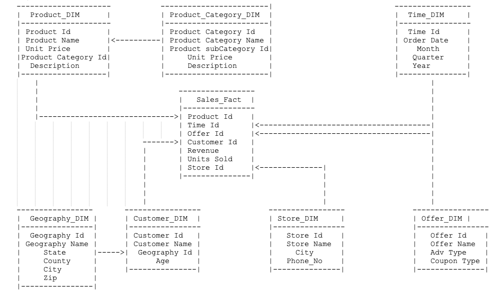

# Oracle Analytic Views – Snowflake Schema Implementation

The important difference from the earlier Star Schema is that Product and Geography are now split into separate related dimension tables. We must preserve these relationships when creating Oracle Attribute Dimensions, Hierarchies and Analytic Views.



## 1. Understand the Snowflake Schema

| SALES_FACT  |
| ----------- |
| PRODUCT_ID  |
| TIME_ID     |
| OFFER_ID    |
| CUSTOMER_ID |
| STORE_ID    |
| REVENUE     |
| UNITS_SOLD  |

| PRODUCT_DIM         |
| ------------------- |
| PRODUCT_ID          |
| PRODUCT_NAME        |
| PRODUCT_CATEGORY_ID |

| PRODUCT_CATEGORY_DIM |
| -------------------- |
| PRODUCT_CATEGORY_ID  |
| CATEGORY_NAME        |
| SUBCATEGORY_ID       |

| CUSTOMER_DIM  |
| ------------- |
| CUSTOMER_ID   |
| CUSTOMER_NAME |
| GEOGRAPHY_ID  |

| GEOGRAPHY_DIM |
| ------------- |
| GEOGRAPHY_ID  |
| COUNTRY       |
| STATE         |
| CITY          |
| ZIP           |

| **TIME_DIM**   |
| -------------- |
| Order Date<br> |
| Month<br>      |
| Quarter<br>    |
| Year           |

| STORE_DIM  |
| ---------- |
| Store Name |
| City<br>   |
| Phone No   |

| OFFER_DIM      |
| -------------- |
| Offer Name<br> |
| Ad Type<br>    |
| Coupon Type    |

### Tables identified

| Table                | Type      | Relationship                |
| -------------------- | --------- | --------------------------- |
| SALES_FACT           | Fact      | Central transaction table   |
| PRODUCT_DIM          | Dimension | References Product Category |
| PRODUCT_CATEGORY_DIM | Dimension | Product classification      |
| TIME_DIM             | Dimension | Time hierarchy              |
| CUSTOMER_DIM         | Dimension | References Geography        |
| GEOGRAPHY_DIM        | Dimension | Geographic hierarchy        |
| STORE_DIM            | Dimension | Store information           |
| OFFER_DIM            | Dimension | Offer information           |

Important design point: Oracle Analytic Views need to connect each analytic dimension to a corresponding key in the fact table. Since `GEOGRAPHY_ID` and `PRODUCT_CATEGORY_ID` are not directly in your fact table, we will create two flattened dimension views to expose their descriptive attributes while retaining the fact-table keys.

# 2. Physical CREATE TABLE statements

The following are proposed physical DDL definitions based on your diagram. I have added surrogate keys for the Geography hierarchy levels because the diagram does not show separate IDs for State, County, City and ZIP.

### A. PRODUCT_CATEGORY_DIM

```
CREATE TABLE PRODUCT_CATEGORY_DIM
(
    PRODUCT_CATEGORY_ID NUMBER PRIMARY KEY,
    PRODUCT_CATEGORY_NAME VARCHAR2(100),
    PRODUCT_SUBCATEGORY_ID NUMBER,
    UNIT_PRICE NUMBER(12,2),
    DESCRIPTION VARCHAR2(500)
);
```

### B. PRODUCT_DIM

```
CREATE TABLE PRODUCT_DIM
(
    PRODUCT_ID NUMBER PRIMARY KEY,
    PRODUCT_NAME VARCHAR2(100),
    UNIT_PRICE NUMBER(12,2),
    PRODUCT_CATEGORY_ID NUMBER,
    DESCRIPTION VARCHAR2(500),

    CONSTRAINT FK_PRODUCT_CATEGORY
    FOREIGN KEY (PRODUCT_CATEGORY_ID)
    REFERENCES PRODUCT_CATEGORY_DIM(PRODUCT_CATEGORY_ID)
);
```

### C. TIME_DIM

```
CREATE TABLE TIME_DIM
(
    TIME_ID NUMBER PRIMARY KEY,
    ORDER_DATE DATE,
    MONTH VARCHAR2(20),
    QUARTER VARCHAR2(20),
    YEAR NUMBER(4)
);
```

For the time hierarchy, a unique month key, quarter key and year key must also be available. We will derive them in a view.

### D. GEOGRAPHY_DIM

```
CREATE TABLE GEOGRAPHY_DIM
(
    GEOGRAPHY_ID NUMBER PRIMARY KEY,
    GEOGRAPHY_NAME VARCHAR2(100),

    COUNTRY_ID NUMBER,
    COUNTRY VARCHAR2(100),

    STATE_ID NUMBER,
    STATE VARCHAR2(100),

    COUNTY_ID NUMBER,
    COUNTY VARCHAR2(100),

    CITY_ID NUMBER,
    CITY VARCHAR2(100),

    ZIP_ID NUMBER,
    ZIP VARCHAR2(15)
);
```

### E. CUSTOMER_DIM

```
CREATE TABLE CUSTOMER_DIM
(
    CUSTOMER_ID NUMBER PRIMARY KEY,
    CUSTOMER_NAME VARCHAR2(100),
    GEOGRAPHY_ID NUMBER,
    AGE NUMBER(3),

    CONSTRAINT FK_CUSTOMER_GEOGRAPHY
    FOREIGN KEY (GEOGRAPHY_ID)
    REFERENCES GEOGRAPHY_DIM(GEOGRAPHY_ID)
);
```

### F. STORE_DIM

```
CREATE TABLE STORE_DIM
(
    STORE_ID NUMBER PRIMARY KEY,
    STORE_NAME VARCHAR2(100),
    CITY VARCHAR2(100),
    PHONE_NO VARCHAR2(20)
);
```

### G. OFFER_DIM

```
CREATE TABLE OFFER_DIM
(
    OFFER_ID NUMBER PRIMARY KEY,
    OFFER_NAME VARCHAR2(100),
    ADV_TYPE VARCHAR2(50),
    COUPON_TYPE VARCHAR2(50)
);
```

### H. SALES_FACT

```
CREATE TABLE SALES_FACT
(
    SALES_ID NUMBER PRIMARY KEY,
    PRODUCT_ID NUMBER NOT NULL,
    TIME_ID NUMBER NOT NULL,
    OFFER_ID NUMBER NOT NULL,
    CUSTOMER_ID NUMBER NOT NULL,
    REVENUE NUMBER(15,2),
    UNITS_SOLD NUMBER(12),
    STORE_ID NUMBER NOT NULL,

    CONSTRAINT FK_SF_PRODUCT
    FOREIGN KEY (PRODUCT_ID)
    REFERENCES PRODUCT_DIM(PRODUCT_ID),

    CONSTRAINT FK_SF_TIME
    FOREIGN KEY (TIME_ID)
    REFERENCES TIME_DIM(TIME_ID),

    CONSTRAINT FK_SF_OFFER
    FOREIGN KEY (OFFER_ID)
    REFERENCES OFFER_DIM(OFFER_ID),

    CONSTRAINT FK_SF_CUSTOMER
    FOREIGN KEY (CUSTOMER_ID)
    REFERENCES CUSTOMER_DIM(CUSTOMER_ID),

    CONSTRAINT FK_SF_STORE
    FOREIGN KEY (STORE_ID)
    REFERENCES STORE_DIM(STORE_ID)
);
```

# 3. Flattened Dimension Views for Snowflake Schema

These views are important because they allow Oracle Analytic Views to access normalized dimension attributes using the key available in `SALES_FACT`.

### A. PRODUCT_ANALYTIC_V

```
CREATE OR REPLACE VIEW PRODUCT_ANALYTIC_V AS
SELECT
    P.PRODUCT_ID,
    P.PRODUCT_NAME,
    P.UNIT_PRICE,
    P.DESCRIPTION,
    C.PRODUCT_CATEGORY_ID,
    C.PRODUCT_CATEGORY_NAME,
    C.PRODUCT_SUBCATEGORY_ID,
    C.UNIT_PRICE AS CATEGORY_UNIT_PRICE
FROM PRODUCT_DIM P
JOIN PRODUCT_CATEGORY_DIM C
  ON P.PRODUCT_CATEGORY_ID =
     C.PRODUCT_CATEGORY_ID;
```

### B. CUSTOMER_GEOGRAPHY_V

```
CREATE OR REPLACE VIEW CUSTOMER_GEOGRAPHY_V AS
SELECT
    C.CUSTOMER_ID,
    C.CUSTOMER_NAME,
    C.AGE,
    G.GEOGRAPHY_ID,
    G.GEOGRAPHY_NAME,
    G.COUNTRY_ID,
    G.COUNTRY,
    G.STATE_ID,
    G.STATE,
    G.COUNTY_ID,
    G.COUNTY,
    G.CITY_ID,
    G.CITY,
    G.ZIP_ID,
    G.ZIP
FROM CUSTOMER_DIM C
JOIN GEOGRAPHY_DIM G
  ON C.GEOGRAPHY_ID = G.GEOGRAPHY_ID;
```

### C. TIME_ANALYTIC_V

We derive unique month, quarter and year keys from the date column.

```
CREATE OR REPLACE VIEW TIME_ANALYTIC_V AS
SELECT
    TIME_ID,
    ORDER_DATE,
    TO_NUMBER(TO_CHAR(ORDER_DATE,'YYYYMM'))
        AS MONTH_ID,
    TO_CHAR(ORDER_DATE,'MON') AS MONTH_NAME,
    TO_NUMBER(TO_CHAR(ORDER_DATE,'YYYYQ'))
        AS QUARTER_ID,
    'Q' || TO_CHAR(ORDER_DATE,'Q') AS QUARTER_NAME,
    TO_NUMBER(TO_CHAR(ORDER_DATE,'YYYY'))
        AS YEAR_ID,
    TO_CHAR(ORDER_DATE,'YYYY') AS YEAR_NAME
FROM TIME_DIM;
```

Note: These are logical views, not additional physical fact or dimension tables. They preserve the snowflake relationships while exposing the required dimension attributes to Oracle Analytics.

# 4. Oracle ATTRIBUTE DIMENSION CREATE statements

We now create the metadata objects following the format in your reference document.

## A. PRODUCT_ATTR_DIM

Levels: Product → Subcategory → Category

```
CREATE OR REPLACE ATTRIBUTE DIMENSION
PRODUCT_ATTR_DIM
USING PRODUCT_ANALYTIC_V

ATTRIBUTES
(
    PRODUCT_ID,
    PRODUCT_NAME,
    UNIT_PRICE,
    DESCRIPTION,
    PRODUCT_CATEGORY_ID,
    PRODUCT_CATEGORY_NAME,
    PRODUCT_SUBCATEGORY_ID
)

LEVEL PRODUCT
    KEY PRODUCT_ID
    MEMBER NAME PRODUCT_NAME
    MEMBER CAPTION PRODUCT_NAME
    ORDER BY PRODUCT_NAME
    DETERMINES
    (
        PRODUCT_CATEGORY_ID,
        UNIT_PRICE,
        DESCRIPTION
    )

LEVEL SUBCATEGORY
    KEY PRODUCT_SUBCATEGORY_ID
    MEMBER NAME PRODUCT_SUBCATEGORY_ID
    MEMBER CAPTION PRODUCT_SUBCATEGORY_ID
    ORDER BY PRODUCT_SUBCATEGORY_ID
    DETERMINES (PRODUCT_CATEGORY_ID)

LEVEL CATEGORY
    KEY PRODUCT_CATEGORY_ID
    ALTERNATE KEY PRODUCT_CATEGORY_NAME
    MEMBER NAME PRODUCT_CATEGORY_NAME
    MEMBER CAPTION PRODUCT_CATEGORY_NAME
    ORDER BY PRODUCT_CATEGORY_NAME

ALL MEMBER NAME 'ALL PRODUCTS';
```

The product subcategory name is not present in your diagram. If you have it in your actual source table, add it to the view and use it as the `MEMBER NAME` and `MEMBER CAPTION` instead of the numeric subcategory ID.

## B. TIME_ATTR_DIM

Levels: Day → Month → Quarter → Year

```
CREATE OR REPLACE ATTRIBUTE DIMENSION
TIME_ATTR_DIM
DIMENSION TYPE TIME
USING TIME_ANALYTIC_V

ATTRIBUTES
(
    TIME_ID,
    ORDER_DATE,
    MONTH_ID,
    MONTH_NAME,
    QUARTER_ID,
    QUARTER_NAME,
    YEAR_ID,
    YEAR_NAME
)

LEVEL DAY
    LEVEL TYPE DAYS
    KEY TIME_ID
    MEMBER NAME ORDER_DATE
    MEMBER CAPTION ORDER_DATE
    ORDER BY ORDER_DATE
    DETERMINES (MONTH_ID)

LEVEL MONTH
    LEVEL TYPE MONTHS
    CLASSIFICATION caption VALUE 'MONTH'
    CLASSIFICATION description VALUE 'Month'
    KEY MONTH_ID
    MEMBER NAME MONTH_NAME
    MEMBER CAPTION MONTH_NAME
    ORDER BY MONTH_ID
    DETERMINES (QUARTER_ID)

LEVEL QUARTER
    LEVEL TYPE QUARTERS
    CLASSIFICATION caption VALUE 'QUARTER'
    CLASSIFICATION description VALUE 'Quarter'
    KEY QUARTER_ID
    MEMBER NAME QUARTER_NAME
    MEMBER CAPTION QUARTER_NAME
    ORDER BY QUARTER_ID
    DETERMINES (YEAR_ID)

LEVEL YEAR
    LEVEL TYPE YEARS
    CLASSIFICATION caption VALUE 'YEAR'
    CLASSIFICATION description VALUE 'Year'
    KEY YEAR_ID
    MEMBER NAME YEAR_NAME
    MEMBER CAPTION YEAR_NAME
    ORDER BY YEAR_ID

ALL MEMBER NAME 'ALL TIME';
```

## C. CUSTOMER_GEOGRAPHY_ATTR_DIM

Levels: ZIP → City → County → State → Country → Geography

```
CREATE OR REPLACE ATTRIBUTE DIMENSION
CUSTOMER_GEOGRAPHY_ATTR_DIM
USING CUSTOMER_GEOGRAPHY_V

ATTRIBUTES
(
    CUSTOMER_ID,
    CUSTOMER_NAME,
    AGE,
    GEOGRAPHY_ID,
    GEOGRAPHY_NAME,
    COUNTRY_ID,
    COUNTRY,
    STATE_ID,
    STATE,
    COUNTY_ID,
    COUNTY,
    CITY_ID,
    CITY,
    ZIP_ID,
    ZIP
)

LEVEL CUSTOMER
    KEY CUSTOMER_ID
    MEMBER NAME CUSTOMER_NAME
    MEMBER CAPTION CUSTOMER_NAME
    ORDER BY CUSTOMER_NAME
    DETERMINES (GEOGRAPHY_ID, AGE)

LEVEL ZIP
    KEY ZIP_ID
    MEMBER NAME ZIP
    MEMBER CAPTION ZIP
    ORDER BY ZIP
    DETERMINES (CITY_ID)

LEVEL CITY
    KEY CITY_ID
    MEMBER NAME CITY
    MEMBER CAPTION CITY
    ORDER BY CITY
    DETERMINES (COUNTY_ID)

LEVEL COUNTY
    KEY COUNTY_ID
    MEMBER NAME COUNTY
    MEMBER CAPTION COUNTY
    ORDER BY COUNTY
    DETERMINES (STATE_ID)

LEVEL STATE
    KEY STATE_ID
    MEMBER NAME STATE
    MEMBER CAPTION STATE
    ORDER BY STATE
    DETERMINES (COUNTRY_ID)

LEVEL COUNTRY
    KEY COUNTRY_ID
    MEMBER NAME COUNTRY
    MEMBER CAPTION COUNTRY
    ORDER BY COUNTRY
    DETERMINES (GEOGRAPHY_ID)

LEVEL GEOGRAPHY
    KEY GEOGRAPHY_ID
    MEMBER NAME GEOGRAPHY_NAME
    MEMBER CAPTION GEOGRAPHY_NAME
    ORDER BY GEOGRAPHY_NAME

ALL MEMBER NAME 'ALL CUSTOMERS';
```

Important hierarchy assumption: This definition treats Geography as a top-level grouping above Country. If Geography Name is simply the name of the geographical record, rather than a parent level, remove the `GEOGRAPHY` level and make `COUNTRY` the top-level level. The hierarchy keys must uniquely identify their members.

## D. STORE_ATTR_DIM

The diagram contains Store and City, but does not provide a unique City ID. We will treat Store as the hierarchy level and City as a descriptive attribute until a proper City key is available.

```
CREATE OR REPLACE ATTRIBUTE DIMENSION
STORE_ATTR_DIM
USING STORE_DIM

ATTRIBUTES
(
    STORE_ID,
    STORE_NAME,
    CITY,
    PHONE_NO
)

LEVEL STORE
    KEY STORE_ID
    MEMBER NAME STORE_NAME
    MEMBER CAPTION STORE_NAME
    ORDER BY STORE_NAME
    DETERMINES (CITY, PHONE_NO)

ALL MEMBER NAME 'ALL STORES';
```

## E. OFFER_ATTR_DIM

Offer Name, Advertisement Type and Coupon Type are treated as attributes rather than a hierarchy because your diagram does not establish a parent-child relationship between them.

```
CREATE OR REPLACE ATTRIBUTE DIMENSION
OFFER_ATTR_DIM
USING OFFER_DIM

ATTRIBUTES
(
    OFFER_ID,
    OFFER_NAME,
    ADV_TYPE,
    COUPON_TYPE
)

LEVEL OFFER
    KEY OFFER_ID
    MEMBER NAME OFFER_NAME
    MEMBER CAPTION OFFER_NAME
    ORDER BY OFFER_NAME
    DETERMINES (ADV_TYPE, COUPON_TYPE)

ALL MEMBER NAME 'ALL OFFERS';
```

# 5. Oracle HIERARCHY CREATE statements

Now we create the hierarchy metadata objects.

### A. PRODUCT_HIER

PRODUCT
SUBCATEGORY
CATEGORY

```
CREATE OR REPLACE HIERARCHY PRODUCT_HIER
USING PRODUCT_ATTR_DIM
(
    PRODUCT
    CHILD OF SUBCATEGORY
    CHILD OF CATEGORY
);
```

### B. TIME_HIER

```
CREATE OR REPLACE HIERARCHY TIME_HIER
USING TIME_ATTR_DIM
(
    DAY
    CHILD OF MONTH
    CHILD OF QUARTER
    CHILD OF YEAR
);
```

### C. GEOGRAPHY_HIER

CUSTOMER
ZIP
CITY
COUNTY
STATE
COUNTRY
GEOGRAPHY

```
CREATE OR REPLACE HIERARCHY GEOGRAPHY_HIER
USING CUSTOMER_GEOGRAPHY_ATTR_DIM
(
    CUSTOMER
    CHILD OF ZIP
    CHILD OF CITY
    CHILD OF COUNTY
    CHILD OF STATE
    CHILD OF COUNTRY
    CHILD OF GEOGRAPHY
);
```

The hierarchy follows the assumption that customer records roll up to ZIP, City, County, State, Country and Geography. Validate that each child maps to exactly one parent.

### D. STORE_HIER

```
CREATE OR REPLACE HIERARCHY STORE_HIER
USING STORE_ATTR_DIM
(
    STORE
);
```

### E. OFFER_HIER

```
CREATE OR REPLACE HIERARCHY OFFER_HIER
USING OFFER_ATTR_DIM
(
    OFFER
);
```

The Store and Offer hierarchies currently have one level each. They provide a consistent hierarchy interface for the Analytic View, but do not introduce additional roll-up levels.

# 6. Oracle ANALYTIC VIEW CREATE statement

Now we bring all five dimensions together with the central `SALES_FACT` table.
The Analytic View will support multidimensional analysis across:

- Product and Product Category
- Time
- Customer and Geography
- Store
- Offer

### SALES_AV — Complete Oracle Analytic View

```
CREATE OR REPLACE ANALYTIC VIEW SALES_AV
USING SALES_FACT

DIMENSION BY
(
    PRODUCT_ATTR_DIM
        KEY PRODUCT_ID REFERENCES PRODUCT_ID
        HIERARCHIES
        (
            PRODUCT_HIER DEFAULT
        ),

    TIME_ATTR_DIM
        KEY TIME_ID REFERENCES TIME_ID
        HIERARCHIES
        (
            TIME_HIER DEFAULT
        ),

    CUSTOMER_GEOGRAPHY_ATTR_DIM
        KEY CUSTOMER_ID REFERENCES CUSTOMER_ID
        HIERARCHIES
        (
            GEOGRAPHY_HIER DEFAULT
        ),

    STORE_ATTR_DIM
        KEY STORE_ID REFERENCES STORE_ID
        HIERARCHIES
        (
            STORE_HIER DEFAULT
        ),

    OFFER_ATTR_DIM
        KEY OFFER_ID REFERENCES OFFER_ID
        HIERARCHIES
        (
            OFFER_HIER DEFAULT
        )
)

MEASURES
(
    REVENUE FACT REVENUE
        DEFAULT AGGREGATE BY SUM,

    UNITS_SOLD FACT UNITS_SOLD
        DEFAULT AGGREGATE BY SUM,

    AVG_REVENUE AS
        (REVENUE / NULLIF(UNITS_SOLD, 0)),

    REVENUE_PRIOR_PERIOD AS
        (LAG(REVENUE)
         OVER (HIERARCHY TIME_HIER OFFSET 1)),

    REVENUE_YEAR_AGO AS
        (LAG(REVENUE)
         OVER (HIERARCHY TIME_HIER OFFSET 1
         ACROSS ANCESTOR AT LEVEL YEAR)),

    REVENUE_QTR_AGO AS
        (LAG(REVENUE)
         OVER (HIERARCHY TIME_HIER OFFSET 1
         ACROSS ANCESTOR AT LEVEL QUARTER)),

    REVENUE_YOY_CHANGE AS
        (LAG_DIFF(REVENUE)
         OVER (HIERARCHY TIME_HIER OFFSET 1
         ACROSS ANCESTOR AT LEVEL YEAR)),

    REVENUE_YOY_PERCENT AS
        (LAG_DIFF_PERCENT(REVENUE)
         OVER (HIERARCHY TIME_HIER OFFSET 1
         ACROSS ANCESTOR AT LEVEL YEAR))
)

DEFAULT MEASURE REVENUE;
```

### Measures explained

| Measure              | Classification | Business purpose                  |
| -------------------- | -------------- | --------------------------------- |
| REVENUE              | Base           | Total sales revenue               |
| UNITS_SOLD           | Base           | Total quantity sold               |
| AVG_REVENUE          | Calculated     | Average revenue per unit          |
| REVENUE_PRIOR_PERIOD | Calculated     | Previous time period revenue      |
| REVENUE_YEAR_AGO     | Calculated     | Same period in previous year      |
| REVENUE_QTR_AGO      | Calculated     | Corresponding previous quarter    |
| REVENUE_YOY_CHANGE   | Calculated     | Year-over-year revenue difference |
| REVENUE_YOY_PERCENT  | Calculated     | Year-over-year percentage change  |

# 7. SQL Queries to validate the Analytic View

Once the Analytic View is successfully created, we can query it using Oracle SQL.

### Example 1: Year-wise Revenue

```
SELECT
    TIME_HIER.MEMBER_NAME AS SALES_YEAR,
    REVENUE,
    UNITS_SOLD
FROM SALES_AV
HIERARCHIES (TIME_HIER)
WHERE TIME_HIER.LEVEL_NAME = 'YEAR'
ORDER BY TIME_HIER.HIER_ORDER;
```

### Example 2: Product Category-wise Revenue

```
SELECT
    PRODUCT_HIER.MEMBER_NAME AS PRODUCT_CATEGORY,
    REVENUE,
    UNITS_SOLD
FROM SALES_AV
HIERARCHIES (PRODUCT_HIER)
WHERE PRODUCT_HIER.LEVEL_NAME = 'CATEGORY'
ORDER BY PRODUCT_HIER.HIER_ORDER;
```

### Example 3: Geography-wise Revenue

```
SELECT
    GEOGRAPHY_HIER.MEMBER_NAME AS GEOGRAPHY,
    REVENUE,
    UNITS_SOLD
FROM SALES_AV
HIERARCHIES (GEOGRAPHY_HIER)
WHERE GEOGRAPHY_HIER.LEVEL_NAME IN
      ('COUNTRY', 'STATE', 'CITY', 'ZIP')
ORDER BY GEOGRAPHY_HIER.HIER_ORDER;
```

### Example 4: Year-wise Revenue Comparison

```
SELECT
    TIME_HIER.MEMBER_NAME AS SALES_YEAR,
    REVENUE,
    REVENUE_YEAR_AGO,
    REVENUE_YOY_CHANGE,
    REVENUE_YOY_PERCENT
FROM SALES_AV
HIERARCHIES (TIME_HIER)
WHERE TIME_HIER.LEVEL_NAME = 'YEAR'
ORDER BY TIME_HIER.HIER_ORDER;
```

### Example 5: Product and Geography-wise Sales

```
SELECT
    PRODUCT_HIER.MEMBER_NAME AS PRODUCT,
    GEOGRAPHY_HIER.MEMBER_NAME AS GEOGRAPHY,
    REVENUE,
    UNITS_SOLD
FROM SALES_AV
HIERARCHIES
(
    PRODUCT_HIER,
    GEOGRAPHY_HIER
)
WHERE PRODUCT_HIER.LEVEL_NAME = 'CATEGORY'
  AND GEOGRAPHY_HIER.LEVEL_NAME = 'COUNTRY'
ORDER BY
    PRODUCT_HIER.HIER_ORDER,
    GEOGRAPHY_HIER.HIER_ORDER;
```

# 8. Complete execution sequence
Execute the scripts in this order.

1. Create physical Dimension Tables
   PRODUCT_CATEGORY_DIM, PRODUCT_DIM, TIME_DIM, GEOGRAPHY_DIM, CUSTOMER_DIM, STORE_DIM, OFFER_DIM
   
2. Create SALES_FACT
   Establish foreign key relationships to the five directly referenced dimensions.
   
3. Create flattened dimension views
   PRODUCT_ANALYTIC_V, CUSTOMER_GEOGRAPHY_V, TIME_ANALYTIC_V

4. Create Attribute Dimensions
   PRODUCT_ATTR_DIM, TIME_ATTR_DIM, CUSTOMER_GEOGRAPHY_ATTR_DIM, STORE_ATTR_DIM, OFFER_ATTR_DIM

5. Create Hierarchies
   PRODUCT_HIER, TIME_HIER, GEOGRAPHY_HIER, STORE_HIER, OFFER_HIER

6. Create SALES_AV
   Define all five dimensions and sales measures.

7. Execute validation queries
   Validate aggregation, hierarchy navigation and calculated measures.


# 9. Important design considerations before execution

There are four things I would correct or validate before treating these scripts as production-ready.

| Area             | Recommendation                                                                                                                         |
| ---------------- | -------------------------------------------------------------------------------------------------------------------------------------- |
| Product Category | Your diagram does not show a Subcategory Name or a separate Subcategory table. Confirm the intended category/subcategory relationship. |
| Geography        | Use unique parent-level IDs for Country, State, County, City and ZIP. Ensure each child has one parent.                                |
| Time             | Ensure the time dimension has one record per date and valid, unique month, quarter and year keys.                                      |
| Store            | If City-wise roll-up is required, introduce a CITY_DIM with a CITY_ID and a foreign key from STORE_DIM.                                |

Also, the `CUSTOMER_GEOGRAPHY_ATTR_DIM` is a proposed flattened analytic dimension, not a separate physical dimension table. It allows the fact table's `CUSTOMER_ID` to connect to geographic attributes through the customer-to-geography relationship.

Oracle compatibility: The scripts follow the Oracle Analytic View syntax and patterns in your reference document, but should be validated against your actual Oracle Database release. In particular, confirm the hierarchy level-key uniqueness, classification support, and calculated-measure expressions. The sample queries also assume that the hierarchy metadata exposes the referenced member and ordering attributes.

## 10. Final Snowflake Schema implementation summary

| Component                 | Number of objects |
| ------------------------- | ----------------- |
| Physical Dimension Tables | 7                 |
| Physical Fact Tables      | 1                 |
| Flattened Analytic Views  | 3                 |
| Attribute Dimensions      | 5                 |
| Hierarchies               | 5                 |
| Analytic Views            | 1                 |
| Sample validation queries | 5                 |

Key difference from Star Schema: In a Star Schema, dimension attributes are generally stored in a single denormalized dimension table. In your Snowflake Schema, Product Category and Geography are separated into their own related tables. The flattened analytic views make those relationships available to Oracle Analytic Views without changing the underlying physical Snowflake Schema.

This gives you a proposed end-to-end Oracle Analytics implementation based on your supplied Snowflake diagram and reference document.
