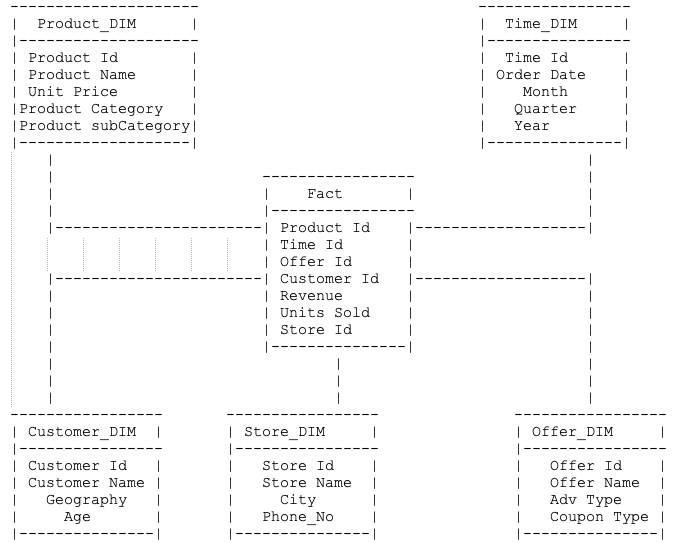

**Analytic View (AV):**
 - "Tools" for presenting data from DWH to Application Developers & Business users. 
	Ex: BI Application Tools: OBIEE, Tableau, Power BI, Qlik etc generates queries, gets the data and presents the result.
 - "Metadata objects" enabling user to create HD ("Hierarchical" & "Dimensional") queries on data from database tables & views.
 - Organizes data using following models:
	-- a dimensional model (explained above with star, snow flake schemas) or
	-- a hierarchical model.
 - Add aggregations and calculations on data sets that can be queried with SQL.
 - Defined over the dimension tables and fact table of a star / snowflake schema / a denormalized table, where dimension attributes & fact data are in the same table.
 - Most performant schema is a star schema loaded into in-memory column store, using the Oracle Database In-Memory Option.
 - Advantage of materialized views to further accelerate aggregate level queries.
	-- Star Cache       - MVs created to accelerate queries that select from a Dimension.
	-- Aggregate Cache  - MVs with aggregate level data used to accelerate queries that select from an analytic view.

 - Requirements for an analytic view:
	-- A dimension table (or view): This table should have a primary key that provides a unique list of values and that joins to the fact table.
	-- A fact table with at least one fact (measure) column and a key column that joins to the primary key of the dimension table.

 - Characteristics of an analytic view:
	-- Is defined over using two or more dimension tables, enabling the ability to slice and dice data.
	-- One or more of the dimension tables contain data at different levels of aggregation (Ex: days, months, quarters, and years).

 - AV Comprises of three types of objects: 
	-- Attribute dimensions:A metadata object that references tables or views & organizes columns into higher-level objects such as attributes and levels.
	-- Hierarchies:		    A type of view that organizes data using hierarchical relationships.
	-- Analytic Views:	    A type of view that returns fact data.

 - Measures of Analytic Views:
     -- Measures specific fact data and the calculations
     -- Types:
	    Base Measures:
	        -> a reference to a column in a fact table.
	        -> specifies a default aggregation like SUM or AVG or a complex nesting of operations that vary by attribute dimension
	        -> use default_aggregate_clause to specify a default aggregation method for base measures, default value = SUM
	    Calculated Measures:
	        -> an expression that can be a user-defined expression or one of the many pre-defined analytic calculations.
	        -> an expression that includes other measures, row functions, and hierarchy functions.
	        -> Includes following operations:
		        -> Lead and lag
                -> Qualified data reference (QDR)
                -> Rank
		        -> Related member
		        -> Share of Window calculations



# 1. Proposed Oracle Data Warehouse structure

| **SALES_FACT** |
| -------------- |
| SALES_ID       |
| PRODUCT_ID     |
| TIME_ID        |
| OFFER_ID       |
| CUSTOMER_ID    |
| STORE_ID       |
| REVENUE        |
| UNITS_SOLD     |

| **PRODUCT_DIM** |
| --------------- |
| Product Name    |
| Category        |
| Subcategory     |

| **TIME_DIM**   |
| -------------- |
| Order Date<br> |
| Month<br>      |
| Quarter<br>    |
| Year           |

| OFFER_DIM      |
| -------------- |
| Offer Name<br> |
| Ad Type<br>    |
| Coupon Type    |

| CUSTOMER_DIM  |
| ------------- |
| Customer Name |
| Geography<br> |
| Age           |

| STORE_DIM  |
| ---------- |
| Store Name |
| City<br>   |
| Phone No   |

Five dimension tables connected to the central sales fact table through foreign keys.

## 2. Design assumptions

Your diagram provides descriptive attributes but does not specify all hierarchy keys. To make the Oracle Analytic Views executable, I am introducing the following supporting columns:

| Dimension | Hierarchy levels                 | Additional columns            |
| --------- | -------------------------------- | ----------------------------- |
| Product   | Product → Subcategory → Category | Subcategory_ID, Category_ID   |
| Time      | Day → Month → Quarter → Year     | Month_ID, Quarter_ID, Year_ID |
| Customer  | Geography                        | Geography_ID                  |
| Store     | City                             | City_ID                       |
| Offer     | Offer → Ad Type → Coupon Type    | Ad_Type_ID, Coupon_Type_ID    |

For the Customer, Store and Offer dimensions, these are proposed analytical groupings, not confirmed business hierarchies. Their actual parent-child relationships should be validated with your business definitions.

The fact table will have one row per sales transaction or defined sales-grain combination, with Revenue and Units Sold as measures.

# 3. Oracle CREATE TABLE statements

These are the physical tables required before creating Oracle metadata objects.
### A. PRODUCT_DIM
```
CREATE TABLE PRODUCT_DIM (
    PRODUCT_ID          NUMBER PRIMARY KEY,
    PRODUCT_NAME        VARCHAR2(100),
    UNIT_PRICE          NUMBER(12,2),
    CATEGORY_ID         NUMBER,
    PRODUCT_CATEGORY    VARCHAR2(100),
    SUBCATEGORY_ID      NUMBER,
    PRODUCT_SUBCATEGORY VARCHAR2(100)
);
```

### B. TIME_DIM
```
CREATE TABLE TIME_DIM (
    TIME_ID       NUMBER PRIMARY KEY,
    ORDER_DATE    DATE,
    MONTH_ID      NUMBER,
    MONTH         VARCHAR2(20),
    QUARTER_ID    NUMBER,
    QUARTER       VARCHAR2(20),
    YEAR_ID       NUMBER,
    YEAR          NUMBER(4)
);
```

### C. CUSTOMER_DIM
```
CREATE TABLE CUSTOMER_DIM (
    CUSTOMER_ID   NUMBER PRIMARY KEY,
    CUSTOMER_NAME VARCHAR2(100),
    GEOGRAPHY_ID  NUMBER,
    GEOGRAPHY     VARCHAR2(100),
    AGE           NUMBER(3)
);
```

### D. STORE_DIM
```
CREATE TABLE STORE_DIM (
    STORE_ID   NUMBER PRIMARY KEY,
    STORE_NAME VARCHAR2(100),
    CITY_ID    NUMBER,
    CITY       VARCHAR2(100),
    PHONE_NO   VARCHAR2(20)
);
```

### E. OFFER_DIM
```
CREATE TABLE OFFER_DIM (
    OFFER_ID       NUMBER PRIMARY KEY,
    OFFER_NAME     VARCHAR2(100),
    AD_TYPE_ID     NUMBER,
    AD_TYPE        VARCHAR2(50),
    COUPON_TYPE_ID NUMBER,
    COUPON_TYPE    VARCHAR2(50)
);
```

### F. SALES_FACT
```
CREATE TABLE SALES_FACT (
    SALES_ID    NUMBER PRIMARY KEY,
    PRODUCT_ID  NUMBER NOT NULL,
    TIME_ID     NUMBER NOT NULL,
    OFFER_ID    NUMBER NOT NULL,
    CUSTOMER_ID NUMBER NOT NULL,
    STORE_ID    NUMBER NOT NULL,
    REVENUE     NUMBER(15,2),
    UNITS_SOLD  NUMBER(12),

    CONSTRAINT FK_SALES_PRODUCT
        FOREIGN KEY (PRODUCT_ID)
        REFERENCES PRODUCT_DIM(PRODUCT_ID),

    CONSTRAINT FK_SALES_TIME
        FOREIGN KEY (TIME_ID)
        REFERENCES TIME_DIM(TIME_ID),

    CONSTRAINT FK_SALES_OFFER
        FOREIGN KEY (OFFER_ID)
        REFERENCES OFFER_DIM(OFFER_ID),

    CONSTRAINT FK_SALES_CUSTOMER
        FOREIGN KEY (CUSTOMER_ID)
        REFERENCES CUSTOMER_DIM(CUSTOMER_ID),

    CONSTRAINT FK_SALES_STORE
        FOREIGN KEY (STORE_ID)
        REFERENCES STORE_DIM(STORE_ID)
);
```

Note: These are proposed physical table definitions. The additional IDs are introduced to support proper dimensional keys and hierarchy relationships. If your source tables already exist, map these definitions to the actual column names instead of recreating them.

# 4. Oracle ATTRIBUTE DIMENSION creation
An Attribute Dimension is an Oracle metadata object that identifies the attributes, levels, keys and relationships belonging to a dimension table.
## A. PRODUCT_ATTR_DIM
Hierarchy levels:
- PRODUCT
- SUBCATEGORY
- CATEGORY

Roll-up: Product → Subcategory → Category
```
CREATE OR REPLACE ATTRIBUTE DIMENSION
PRODUCT_ATTR_DIM
USING PRODUCT_DIM
ATTRIBUTES
(
    PRODUCT_ID,
    PRODUCT_NAME,
    UNIT_PRICE,
    SUBCATEGORY_ID,
    PRODUCT_SUBCATEGORY,
    CATEGORY_ID,
    PRODUCT_CATEGORY
)
LEVEL PRODUCT
    KEY PRODUCT_ID
    MEMBER NAME PRODUCT_NAME
    MEMBER CAPTION PRODUCT_NAME
    ORDER BY PRODUCT_NAME
    DETERMINES (UNIT_PRICE, SUBCATEGORY_ID)
LEVEL SUBCATEGORY
    KEY SUBCATEGORY_ID
    MEMBER NAME PRODUCT_SUBCATEGORY
    MEMBER CAPTION PRODUCT_SUBCATEGORY
    ORDER BY PRODUCT_SUBCATEGORY
    DETERMINES (CATEGORY_ID)
LEVEL CATEGORY
    KEY CATEGORY_ID
    MEMBER NAME PRODUCT_CATEGORY
    MEMBER CAPTION PRODUCT_CATEGORY
    ORDER BY PRODUCT_CATEGORY
ALL MEMBER NAME 'ALL PRODUCTS';
```

## B. TIME_ATTR_DIM
This follows the TIME dimension classifications and level types from your pasted notes.
Hierarchy levels:
- DAY
- MONTH
- QUARTER
- YEAR
```
CREATE OR REPLACE ATTRIBUTE DIMENSION
TIME_ATTR_DIM
DIMENSION TYPE TIME
USING TIME_DIM
ATTRIBUTES
(
    TIME_ID,
    ORDER_DATE,
    MONTH_ID,
    MONTH,
    QUARTER_ID,
    QUARTER,
    YEAR_ID,
    YEAR
)
LEVEL DAY
    LEVEL TYPE DAYS
    KEY TIME_ID
    MEMBER NAME ORDER_DATE
    MEMBER CAPTION ORDER_DATE
    ORDER BY ORDER_DATE
    DETERMINES (MONTH_ID)
LEVEL MONTH
    LEVEL TYPE MONTHS
    KEY MONTH_ID
    MEMBER NAME MONTH
    MEMBER CAPTION MONTH
    ORDER BY MONTH_ID
    DETERMINES (QUARTER_ID)
LEVEL QUARTER
    LEVEL TYPE QUARTERS
    KEY QUARTER_ID
    MEMBER NAME QUARTER
    MEMBER CAPTION QUARTER
    ORDER BY QUARTER_ID
    DETERMINES (YEAR_ID)
LEVEL YEAR
    LEVEL TYPE YEARS
    KEY YEAR_ID
    MEMBER NAME YEAR
    MEMBER CAPTION YEAR
    ORDER BY YEAR_ID
ALL MEMBER NAME 'ALL TIME';
```

## C. CUSTOMER_ATTR_DIM
```
CREATE OR REPLACE ATTRIBUTE DIMENSION
CUSTOMER_ATTR_DIM
USING CUSTOMER_DIM
ATTRIBUTES
(
    CUSTOMER_ID,
    CUSTOMER_NAME,
    GEOGRAPHY_ID,
    GEOGRAPHY,
    AGE
)
LEVEL CUSTOMER
    KEY CUSTOMER_ID
    MEMBER NAME CUSTOMER_NAME
    MEMBER CAPTION CUSTOMER_NAME
    ORDER BY CUSTOMER_NAME
    DETERMINES (GEOGRAPHY_ID, AGE)
LEVEL GEOGRAPHY
    KEY GEOGRAPHY_ID
    MEMBER NAME GEOGRAPHY
    MEMBER CAPTION GEOGRAPHY
    ORDER BY GEOGRAPHY;
```

## D. STORE_ATTR_DIM
```
CREATE OR REPLACE ATTRIBUTE DIMENSION
STORE_ATTR_DIM
USING STORE_DIM
ATTRIBUTES
(
    STORE_ID,
    STORE_NAME,
    CITY_ID,
    CITY,
    PHONE_NO
)
LEVEL STORE
    KEY STORE_ID
    MEMBER NAME STORE_NAME
    MEMBER CAPTION STORE_NAME
    ORDER BY STORE_NAME
    DETERMINES (CITY_ID, PHONE_NO)
LEVEL CITY
    KEY CITY_ID
    MEMBER NAME CITY
    MEMBER CAPTION CITY
    ORDER BY CITY;
```

## E. OFFER_ATTR_DIM
```
CREATE OR REPLACE ATTRIBUTE DIMENSION
OFFER_ATTR_DIM
USING OFFER_DIM
ATTRIBUTES
(
    OFFER_ID,
    OFFER_NAME,
    AD_TYPE_ID,
    AD_TYPE,
    COUPON_TYPE_ID,
    COUPON_TYPE
)
LEVEL OFFER
    KEY OFFER_ID
    MEMBER NAME OFFER_NAME
    MEMBER CAPTION OFFER_NAME
    ORDER BY OFFER_NAME
    DETERMINES (AD_TYPE_ID, COUPON_TYPE_ID)
LEVEL AD_TYPE
    KEY AD_TYPE_ID
    MEMBER NAME AD_TYPE
    MEMBER CAPTION AD_TYPE
    ORDER BY AD_TYPE
    DETERMINES (COUPON_TYPE_ID)
LEVEL COUPON_TYPE
    KEY COUPON_TYPE_ID
    MEMBER NAME COUPON_TYPE
    MEMBER CAPTION COUPON_TYPE
    ORDER BY COUPON_TYPE;
```

# 5. Oracle HIERARCHY creation
A Hierarchy defines the parent-child relationships between the levels of an Attribute Dimension.
These objects enable OLAP operations such as:
- Drill-down
- Roll-up
- Hierarchical filtering
- Aggregation at different levels
### A. PRODUCT_HIER
```
CREATE OR REPLACE HIERARCHY PRODUCT_HIER
USING PRODUCT_ATTR_DIM
(
    PRODUCT CHILD OF
    SUBCATEGORY CHILD OF
    CATEGORY
);
```

### B. TIME_HIER
```
CREATE OR REPLACE HIERARCHY TIME_HIER
USING TIME_ATTR_DIM
(
    DAY CHILD OF
    MONTH CHILD OF
    QUARTER CHILD OF
    YEAR
);
```

### C. CUSTOMER_HIER
```
CREATE OR REPLACE HIERARCHY CUSTOMER_HIER
USING CUSTOMER_ATTR_DIM
(
    CUSTOMER CHILD OF
    GEOGRAPHY
);
```

### D. STORE_HIER
```
CREATE OR REPLACE HIERARCHY STORE_HIER
USING STORE_ATTR_DIM
(
    STORE CHILD OF
    CITY
);
```

### E. OFFER_HIER
```
CREATE OR REPLACE HIERARCHY OFFER_HIER
USING OFFER_ATTR_DIM
(
    COUPON_TYPE CHILD OF
    AD_TYPE CHILD OF
    OFFER
);
```

Hierarchy design clarification: The Product and Time hierarchies follow your supplied business structure. Customer, Store and Offer hierarchies are proposed mappings. In particular, Coupon Type and Ad Type are often independent offer classifications rather than parent-child levels. If that is the case in your data, they should be represented as separate attributes instead of this proposed hierarchy.

# 6. Oracle ANALYTIC VIEW creation

This is the most important part of the implementation.
An Analytic View combines:
- Fact table
- Attribute Dimensions
- Hierarchies
- Base Measures
- Calculated Measures

Creating one Analytic View called `SALES_AV`.

### Oracle SQL — SALES_AV
```

CREATE OR REPLACE ANALYTIC VIEW SALES_AV
USING SALES_FACT

DIMENSION BY
(
    TIME_ATTR_DIM
        KEY TIME_ID REFERENCES TIME_ID
        HIERARCHIES (TIME_HIER DEFAULT),

    PRODUCT_ATTR_DIM
        KEY PRODUCT_ID REFERENCES PRODUCT_ID
        HIERARCHIES (PRODUCT_HIER DEFAULT),

    CUSTOMER_ATTR_DIM
        KEY CUSTOMER_ID REFERENCES CUSTOMER_ID
        HIERARCHIES (CUSTOMER_HIER DEFAULT),

    STORE_ATTR_DIM
        KEY STORE_ID REFERENCES STORE_ID
        HIERARCHIES (STORE_HIER DEFAULT),

    OFFER_ATTR_DIM
        KEY OFFER_ID REFERENCES OFFER_ID
        HIERARCHIES (OFFER_HIER DEFAULT)
)

MEASURES
(
    REVENUE FACT REVENUE
        AGGREGATE BY SUM,

    UNITS_SOLD FACT UNITS_SOLD
        AGGREGATE BY SUM,

    AVG_REVENUE AS
        (REVENUE / NULLIF(UNITS_SOLD, 0)),

    REVENUE_PRIOR_PERIOD AS
        (LAG(REVENUE)
         OVER (HIERARCHY TIME_HIER OFFSET 1)),

    REVENUE_YEAR_AGO AS
        (LAG(REVENUE)
         OVER (HIERARCHY TIME_HIER OFFSET 1
         ACROSS ANCESTOR AT LEVEL YEAR))
)

DEFAULT MEASURE REVENUE;
```

The five dimensions are now available for slicing and dicing the sales data. The measures include two base measures and three calculated measures.

| Measure              | Type       | Purpose                                                   |
| -------------------- | ---------- | --------------------------------------------------------- |
| REVENUE              | Base       | Total sales revenue                                       |
| UNITS_SOLD           | Base       | Total units sold                                          |
| AVG_REVENUE          | Calculated | Revenue per unit sold                                     |
| REVENUE_PRIOR_PERIOD | Calculated | Previous time period's revenue                            |
| REVENUE_YEAR_AGO     | Calculated | Revenue for the corresponding period in the previous year |
Note: The analytic view's calculated measures and hierarchy references should be validated against the Oracle Database version and the hierarchy's available levels before deployment.

# 7. Query the Oracle Analytic View
Once the Attribute Dimensions, Hierarchies and Analytic View have been created successfully, business users can query the Analytic View directly.
Unlike querying the fact table using multiple joins, the Analytic View exposes business-friendly hierarchical attributes and measures.
### Example 1: Annual revenue
```
SELECT
    TIME_HIER.MEMBER_NAME AS SALES_YEAR,
    REVENUE,
    UNITS_SOLD
FROM SALES_AV
HIERARCHIES (TIME_HIER)
WHERE TIME_HIER.LEVEL_NAME = 'YEAR'
ORDER BY TIME_HIER.HIER_ORDER;
```

### Example 2: Product category-wise revenue
```
SELECT
    PRODUCT_HIER.MEMBER_NAME AS PRODUCT,
    REVENUE,
    UNITS_SOLD
FROM SALES_AV
HIERARCHIES (PRODUCT_HIER)
WHERE PRODUCT_HIER.LEVEL_NAME = 'CATEGORY'
ORDER BY PRODUCT_HIER.HIER_ORDER;
```

### Example 3: Sales by Year, Product Category and Store City
```
SELECT
    TIME_HIER.MEMBER_NAME AS SALES_YEAR,
    PRODUCT_HIER.MEMBER_NAME AS PRODUCT_CATEGORY,
    STORE_HIER.MEMBER_NAME AS STORE_CITY,
    REVENUE,
    UNITS_SOLD
FROM SALES_AV
HIERARCHIES
(
    TIME_HIER,
    PRODUCT_HIER,
    STORE_HIER
)
WHERE TIME_HIER.LEVEL_NAME = 'YEAR'
  AND PRODUCT_HIER.LEVEL_NAME = 'CATEGORY'
  AND STORE_HIER.LEVEL_NAME = 'CITY'
ORDER BY
    TIME_HIER.HIER_ORDER,
    PRODUCT_HIER.HIER_ORDER,
    STORE_HIER.HIER_ORDER;
```

### Example 4: Previous-year revenue comparison
```
SELECT
    TIME_HIER.MEMBER_NAME AS SALES_YEAR,
    REVENUE,
    REVENUE_YEAR_AGO
FROM SALES_AV
HIERARCHIES (TIME_HIER)
WHERE TIME_HIER.LEVEL_NAME = 'YEAR'
ORDER BY TIME_HIER.HIER_ORDER;

```

# 8. Execution sequence
Execute the scripts in the following order to avoid dependency errors.
1. Create physical Dimension Tables
   PRODUCT_DIM, TIME_DIM, CUSTOMER_DIM, STORE_DIM, OFFER_DIM
2. Create Physical Fact Table
   SALES_FACT with foreign keys to all five dimensions
3. Create Attribute Dimensions
   PRODUCT_ATTR_DIM, TIME_ATTR_DIM, CUSTOMER_ATTR_DIM, STORE_ATTR_DIM, OFFER_ATTR_DIM
4. Create Hierarchies
   PRODUCT_HIER, TIME_HIER, CUSTOMER_HIER, STORE_HIER, OFFER_HIER
5. Create Analytic View
   SALES_AV
6. Execute validation queries
   Verify levels, measures, aggregation and drill-down results.

## 9. Important Oracle syntax corrections and implementation notes
A few details are important before deploying these scripts:

A. Base measure aggregation syntax
To follow Oracle's `DEFAULT_AGGREGATE` syntax, the base measures in the Analytic View should be written as:
```
REVENUE FACT REVENUE DEFAULT AGGREGATE BY SUM,
UNITS_SOLD FACT UNITS_SOLD DEFAULT AGGREGATE BY SUM
```
Use this in place of the shorter `AGGREGATE BY SUM` clauses in the earlier Analytic View script.

B. Time dimension classifications
Your supplied notes include classifications for time attributes and levels. For example:
```
LEVEL MONTH
    LEVEL TYPE MONTHS
    CLASSIFICATION caption VALUE 'MONTH'
    CLASSIFICATION description VALUE 'Month'
    KEY MONTH_ID
    MEMBER NAME MONTH
    MEMBER CAPTION MONTH
    ORDER BY MONTH_ID
```
The same approach can be applied to YEAR and QUARTER, using `YEARS` and `QUARTERS` respectively. You can also add captions and descriptions to the individual time attributes.

C. Data quality requirements
Before creating the hierarchies, ensure:
- Each dimension primary key is unique.
- Each child level maps consistently to its parent.
- Time dimension records have valid month, quarter and year relationships.
- The dimension foreign keys in SALES_FACT match existing dimension records.
- All hierarchy levels have the required key and member attributes.

D. Oracle version compatibility
Oracle Analytic Views require a database version and configuration that support the relevant AV features. Validate the scripts in your target Oracle environment, particularly the calculated measure expressions and classification clauses.

## 10. Final deliverables covered

| Component                 | Objects | Status   |
| ------------------------- | ------- | -------- |
| Physical Dimension Tables | 5       | Prepared |
| Physical Fact Table       | 1       | Prepared |
| Attribute Dimensions      | 5       | Prepared |
| Hierarchies               | 5       | Proposed |
| Analytic View             | 1       | Prepared |
| Sample AV Queries         | 4       | Prepared |

My recommendation: Before production deployment, I would validate the proposed Customer, Store and Offer hierarchies with your actual business hierarchy definitions. The Product and Time hierarchies are the strongest matches to your diagram and supplied notes.

The result is a complete proposed Oracle Analytics metadata design for your Sales Star Schema, covering physical tables through Analytic Views and business-facing SQL queries.