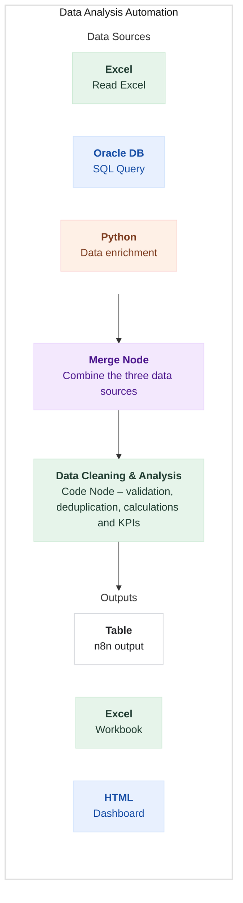

Sample **n8n Data Analysis Automation Template** that combines three data sources:

1. **Oracle Database** – Customer and transaction records.
2. **Excel Sheet** – Sales and product information.
3. **Python Script** – Data enrichment, calculations, and data processing.

The combined dataset is cleaned, analysed, and presented in three output formats:

- Table displayed in n8n execution results.
- Downloadable Excel workbook with multiple sheets.
- Standalone HTML dashboard with KPI cards, regional analysis, product analysis, and data preview.

I have used fictional sales data for this demonstration so that you can test the workflow without requiring access to your actual Oracle database.

## **1. Output – Table**

Sample analysis results

**Sales Analysis – October 2026**

| Customer       | Region | Product  | Units | Revenue (₹) |
| -------------- | ------ | -------- | ----- | ----------- |
| Asha Rao       | South  | Laptop   | 2     | 1,30,000    |
| Rahul Menon    | West   | Monitor  | 3     | 43,500      |
| Divya Iyer     | South  | Keyboard | 5     | 11,000      |
| Arjun Das      | North  | Laptop   | 1     | 68,000      |
| Neha Shah      | West   | Headset  | 4     | 14,000      |
| Vikram Nair    | South  | Monitor  | 2     | 30,000      |
| Sara Khan      | East   | Laptop   | 1     | 64,000      |
| Rohan Patel    | West   | Keyboard | 6     | 12,600      |
| Meera Krishnan | East   | Headset  | 3     | 10,800      |
| Dev Kumar      | South  | Laptop   | 2     | 1,31,000    |

**Summary KPIs**

Total Revenue

# **₹5,15,900**

Total Orders

# **10**

Total Units Sold

# **29**

Average Order Value

# **₹51,590**

## **2. Output – Downloadable Excel Workbook**

**n8n_data_analysis_sample_output.xlsx**

Excel workbook containing four worksheets

Download Excel Workbook

The workbook contains:

- Sheet 1 – Combined Data
- Sheet 2 – KPI Summary
- Sheet 3 – Region Analysis
- Sheet 4 – Product Analysis

## **3. Output – Interactive HTML Dashboard**

**n8n_data_analysis_dashboard.html**

Standalone HTML dashboard – open in Chrome or Safari

Download HTML Dashboard

The dashboard includes:

- Total Revenue, Orders, Units Sold and Average Order Value.
- Revenue by Region.
- Revenue by Product.
- Combined dataset preview.
- Responsive layout for Mac and mobile screens.

## **4. Downloadable n8n Workflow Template**

**Oracle + Excel + Python Data Analysis**

Importable JSON starter template

Download n8n Workflow JSON

Additional files:

- Sample Excel input file
- Python enrichment script

## **5. Workflow Architecture**

This is the intended n8n execution flow:

## **Data Analysis Automation**

**Excel**

Read Excel

**Oracle DB**

SQL Query

**Python**

Data enrichment

**Merge Node**

Combine the three data sources

**Data Cleaning & Analysis**

Code Node – validation, deduplication, calculations and KPIs

**Table**

n8n output

**Excel**

Workbook

**HTML**

Dashboard

## **6. Important setup before running**

The workflow JSON is a starter template and needs these configurations:

1. Mount your Excel input file and Python script into the n8n container.
2. Configure your Oracle database credentials and replace the sample SQL query with your actual table and column names.
3. Provide the Python input JSON file expected by the sample script.
4. Configure the output directory `/files/output` and ensure it is writable.

**One important technical distinction:** The current Merge node uses Append mode, which combines incoming records. If your Excel and Oracle records need to be matched using `customer_id`, configure a Merge-by-Fields operation instead. Also, the supplied Python script is a starter enrichment example, not a complete production data integration layer.

## **7. Suggested next enhancement**

Once this template works, I recommend upgrading it to a more complete local Data Science and BI platform:

- Python Pandas / Polars for data engineering.
- Scikit-learn for anomaly detection and clustering.
- Ollama (Qwen3) for natural-language data analysis.
- Metabase for live BI dashboards.
- Wren AI for natural-language-to-SQL analytics.
- Slack for automated alerts.

This would take your original Mac mini architecture from a basic n8n automation workflow to a complete local AI-assisted Data Analytics pipeline.